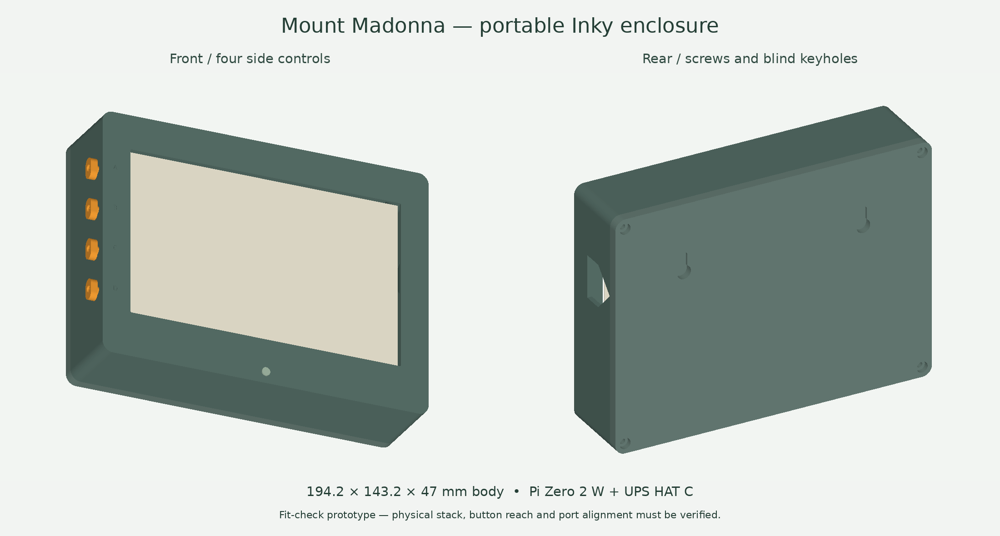

# Mount Madonna portable Inky case — prototype v0.1

[Download all STL, STEP and source files](Mount_Madonna_Case_v0_1.zip) · [Dimension sheet](dimensions.pdf) · [1:1 wall template](wall_template_1to1.pdf)

This is a new parametric enclosure for the **Pimoroni Inky Impression 7.3-inch
2025 board with SIDE buttons**, a **Pi Zero 2 W**, and a **Waveshare UPS HAT (C)**
with its 803040 battery. It has an integral front/body, a screw-fastened back,
four captive side controls, a covered charging bay, and two blind keyhole wall
mounts. The original reference meshes are not required to build it.

**Fit-check prototype, not a physically tested enclosure.** Published PCB and
screen dimensions were used, but the assembled stack thickness, button height,
and socket position are estimates. The user authorized extra depth. The assumed
Pi/UPS stack ends 32.1 mm behind the front datum; the inside back is at 41 mm,
leaving approximately **8.9 mm spare depth**. Please print the two fit gauges
and one button pair before committing to the main parts.

## Size and contents

- Main enclosure: **194.2 × 143.2 × 47 mm** assembled (landscape).
- Body: 41 mm deep. Back: 6 mm plate with a 1.8 mm registration lip.
- Button caps and charging cover extend beyond the main footprint. Total width
  with them is approximately **200.6 mm**. They print as separate parts.
- Visible opening: 161 × 97 mm over the 160 × 96 mm active display.
- Four board mounts: 168.2 × 117.2 mm centre spacing (3 mm inset from PCB edges).
- Buttons: 24 mm spacing, A at top, through D at bottom.
- Wall screws: 110 mm horizontal centres; lift case 10 mm, then pull away.
- No desktop stand, open rear, or always-open ventilation slots.
- This is **not waterproof, dust-rated, impact-certified, or a vehicle mount**.
  The recessed screen and port cover provide basic protection only.

The case is designed for the display's side-button revision, not the later
rear-button board. The four programs and their software do not need changing.
The existing update gesture is retained mechanically through the four controls.

## Files

`exports/` contains an STL and STEP for each part, plus `case_assembly.step` with
all parts at their assembly coordinates. STL parts are individually shifted to
nonnegative coordinates at bed level. **Do not assemble the normalized STLs
by their origins**; use the assembly STEP for alignment.

Print quantities:

| File | Quantity | Notes |
|---|---:|---|
| body.stl | 1 | Front bezel and case walls in one part |
| back_panel.stl | 1 | Four screws, blind keyholes, alignment lip |
| button_plunger.stl | 4 | Captive inside flange and threaded pilot |
| button_cap.stl | 4 | Outside capsule head; M2 screw retains it |
| charge_port_plug.stl | 1 | Removable cover, preferably TPU |
| led_blank.stl | 0 or 1 | Use if not fitting a 3 mm indicator LED |
| pcb_fit_gauge.stl | 1 first | Checks board outline / mounting centres |
| button_fit_coupon.stl | 1 first | Checks plunger clearance in the guide |

Use a build plate with at least 200 × 150 mm usable area; **220 × 220 mm or
larger is recommended** for brims/skirt. This is not split for a 180 mm printer.

## Printing

- PETG is a good first choice. ASA is another option if your printer supports it.
  PLA can soften in a hot parked vehicle; do not leave the battery unit in heat.
- Start with a 0.2 mm layer height, four perimeters, and 20–30% infill.
- Body: front face flat on the bed, rear cavity pointing up. The charging bay
  has a sloped roof. The front lettering is recessed.
- Back: exterior/keyhole face down, registration lip up. The STL is already
  oriented this way. The closed pocket skins bridge about 8.4 mm; test your
  printer's bridging. Keep support out of the sliding pockets if possible.
- Caps: outer button face on the bed (STL already oriented).
- Plungers: small screw-pilot end on the bed (STL already oriented); use a small
  brim. Their retaining flanges flare at 45 degrees to reduce support needs.
- Port cover: outer flange down (STL already oriented). TPU is preferred; a
  rigid PETG plug may need sanding and should not be forced into the opening.
- LED blank: outer flange down. Gauges: flat as supplied.
- Inspect/sand the button bores and cap sockets. Do not scale the full enclosure
  to compensate for a tight moving part; adjust only the relevant parameter.

## Hardware

- Four M3 × 10 mm screws suitable for threading into plastic for the rear panel
  (head diameter no more than 6.6 mm; head height no more than 3.2 mm).
- Four M2 × 4 mm screws suitable for plastic for the display's corner mounts.
- Four M2 × 4 mm screws for the button caps.
- Two wall screws with a shank up to 4 mm, head diameter about 7–8 mm, and head
  thickness at most 2.8 mm. Choose anchors appropriate for the wall.
- Keep the manufacturer's Pi/header/UPS spacers and hardware.

The pilot holes are for plastic-threading screws, not heat-set inserts. Test
thread fit on spare material first; a small M2/M3 tap can also be used if
appropriate for your screws. Do not substitute longer display-mount screws:
check engagement and clearance against the actual display before tightening.

## Fit checks and assembly

1. **Power down, unplug and disconnect the battery before working on hardware.**
   Protect the fragile glass; support the PCB edges rather than pressing it.
2. Lay the PCB against the fit gauge. Confirm outline and all four mounting
   centres. The gauge is not a clamp and must not be pressed against the glass.
3. Print one cap, plunger and guide coupon. The shaft should move freely, with
   no binding after the screw is fitted. File only printing burrs.
4. Dry-fit the display into the body from the back. It seats on four small
   corner pads. The glass has a larger relief pocket behind the front lip;
   the front must not clamp or press the glass. Secure at the four PCB holes
   with the short M2 screws, gently.
5. Fit each plunger from inside, then add its outer cap and M2 screw. Align the
   tips with the actual side-switch actuators. Each should return freely and
   must **not hold the switch pressed at rest**. The geometry estimates button
   Z = 7.25 mm and tip reach. If needed, sand the tips slightly or edit
   `button_z` / `button_tip_x` and regenerate. Verify A, B, C and D individually,
   plus the A+D hold, before closing the case. No button screw should touch the
   switch or PCB directly.
6. Fit the Pi Zero 2 W and UPS using their normal header, pogo pins and spacers.
   The UPS battery stays attached in its intended position. Do not clamp,
   compress, pierce, or tightly strap the pouch cell. Route wires away from
   screw bosses and button mechanisms.
7. Check the charging bay against your actual UPS socket. The estimated socket
   location is on the opposite side from the controls, inboard of the wall.
   The bay is intentionally generous to allow a cable to reach it. It suits
   charging access rather than an exact socket-shaped seal. If its position
   differs, edit the port parameters before printing the body. The UPS HAT C
   published drawing shows micro-USB B; confirm your particular revision.
8. Fit a 3 mm indicator LED in the lower front hole if desired, using the
   existing suitable wiring/current limiting, or fit the printed blank.
   The case adds no electrical connections. Ensure nothing shorts the PCB.
9. Remove the charging cover, then dry-fit the back. Verify battery and header clearance, then fasten the four
   rear screws. Do not use the screws to force a tight assembly closed.
10. Check all four views and charging operation. The UPS power switch is
    accessible after removing the back; no guessed external switch lever is
    included.

The window is deliberately recessed. For an additional transparent guard, a
0.5 mm clear PET/polycarbonate sheet can be cut approximately 169.8 × 110.8 mm
and placed in the front relief pocket, secured only to the plastic perimeter.
Check the actual glass clearance first: the nominal gap is small and this
optional sheet must not contact the glass when flexed. It is not a waterproof
seal and does not make the display resistant to hard impacts.

## Wall mounting and field use

Drill two wall fastener positions **110 mm apart**, level. Use the included
1:1 wall template PDF, printed at Actual Size (not Fit to Page), and verify its
100 mm scale bar with a ruler. Screw-head projections depend on the chosen
heads: adjust for a snug sliding fit against the back panel, without forcing.

Align the large lower entries over the screw heads, then slide the case down
10 mm so the screws enter the narrow upper slots. The keyholes are **blind**:
a solid inner skin separates them from the electronics. To carry the unit,
lift 10 mm and pull it off. Remove the charge cover only while accessing the
socket. The cover is not latched; secure it separately if a loose plug would
be inconvenient. Disconnect the cable before taking it off the wall.

This is a lift-off indoor wall mount, not a crash-restraint for a vehicle.
The enclosure is not rainproof; use sheltered conditions or a suitable dry bag
when necessary. Check that normal charging does not cause excessive enclosure
or battery heating before extended use.

## Editing and validation

The model is independently rebuilt parametrically; it does not depend on mesh
booleans or include the uploaded STLs. `build_case.py` and `parameters.json`
regenerate all parts with CadQuery 2.6+ (`python build_case.py`). `check_fit.py`
checks ideal-CAD collisions, the PCB envelope, estimated stack clearance and
closed keyhole inner skins. The report files are in `exports/`.

Important assumptions to verify on hardware: PCB corner-hole inset, seating
height, switch Z and plunger reach, actual Pi/UPS stack thickness, charging
socket position, printed clearances, and screw engagement. A valid CAD solid
is not evidence of physical fit, fatigue life, or weather protection.

## Reference sources

- [Pimoroni Inky Impression specifications](https://shop.pimoroni.com/products/inky-impression)
- [Pimoroni dimensional drawing](https://cdn.shopify.com/s/files/1/0174/1800/files/inky-impression-7-drawing.png?v=1781267582)
- [Waveshare UPS HAT C and published outline](https://www.waveshare.com/ups-hat-c.htm)
- [User reference 1 — frame and button geometry](https://makerworld.com/en/models/1482862-inky-impression-2025-edition-7-3-frame)
- [User reference 2 — enclosure layout](https://makerworld.com/en/models/2835228-pimoroni-inky-impression-7-3-v2025-case)

PCB outline: 174.2 × 123.2 mm; active area: 160 × 96 mm. Waveshare UPS PCB:
65 × 30 mm; hole centres: 58 × 23 mm; battery designation: 803040. The complete
assembled thickness was not published/confirmed and was estimated as requested.
The source meshes were inspected for scale and spacing; this new case is not
an exact-fit derivative of either reference and has not been test-printed.
