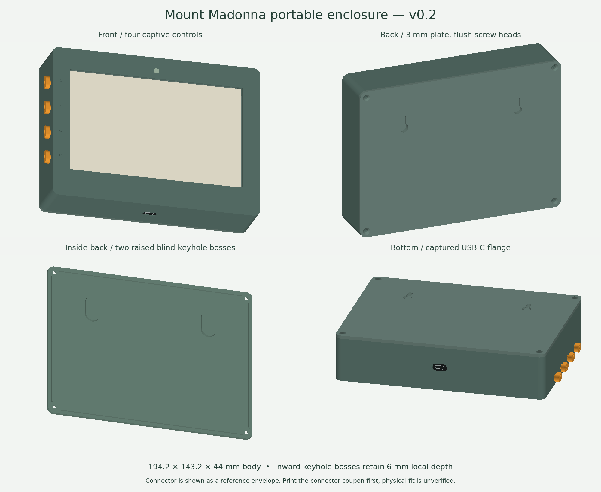

# Mount Madonna portable Inky case — prototype v0.2

[Download STL, assembly STEP and source package](Mount_Madonna_Case_v0_2.zip) · [Dimension sheet](dimensions.pdf) · [1:1 wall template](wall_template_1to1.pdf)

A parametric enclosure for the **2025 side-button Inky Impression 7.3**,
**Pi Zero 2 W**, and **Waveshare UPS HAT (C)**. Version 0.2 adds the requested
bottom XIITIA USB-C input and a thinner rear panel with local inward keyhole
bosses. All four side controls and the screw-fastened back remain.

**Fit-check prototype:** CAD solids and meshes are checked, but nothing has
been physically test-printed. The electronics stack, button reach and print
clearances remain estimates. Print the small connector coupon and one button
pair first. The two source reference models were used for dimensions/layout;
this is a new independent parametric model, not an exact-fit mesh derivative.

## Changes from v0.1

- Main size: **194.2 × 143.2 × 44 mm**, down from 47 mm deep.
- Rear plate: **3 mm**, down from 6 mm.
- Two local keyhole bosses extend **3 mm inward**. Each retains **6 mm total
  local depth**, including a solid 1.5 mm inside skin and blind head cavity.
- The centre of the cavity keeps about **8.9 mm** spare depth behind the
  estimated stack. The nearest keyhole boss has about **5.9 mm** clearance
  above the estimated stack envelope.
- The original side USB access hole and removable plug are removed. That wall
  is closed. The USB-C connector now mounts at the **bottom centre**.
- Rear fasteners are now **M3 flat-head/countersunk screws**, to sit flush in
  the thinner plate. Do not use v0.1's pan-head screws in these countersinks.
- Wall mounting remains **110 mm centres** with **10 mm lift-off travel**.
  Existing wall-screw locations can be retained if the head fit is correct.

The LED aperture is aligned with the **onboard LED at the top centre** of the
display PCB (3 mm below its top edge). The former lower-front opening is closed.

Only the USB-C connector's lip projects below the case. Button caps still
project past the side; maximum width with controls is approximately 199.4 mm.
The rear panel STL is 6 mm deep at its bosses even though the broad plate is
3 mm thick. This is intentional.

## Bottom USB-C connector

Reference part: XIITIA ASIN **B0CHDVVDWN**, the two-wire pigtail shown in the
user-supplied dimension image. The image specifies a **15.5 × 9 mm face flange**,
**11 mm insertion depth**, and approximately **105 mm wires**. It does not
specify the snap-tab mounting-hole dimensions.

This case captures the known flange with a screw-on internal retainer:

- Flange recess: 15.9 × 9.4 mm capsule (0.4 mm total nominal clearance).
- Outside plug aperture: 13.2 × 7 mm capsule.
- Connector front setback: 0.8 mm from the bottom surface.
- Two retainer screws: M2 × 10 mm, 24 mm centres.
- Rear retainer has an 8 × 5 mm wire exit and a nominal 0.3 mm gap behind the
  11 mm connector envelope. A small compliant pad around the wire exit may
  take up play; do not bear on or pinch the pigtail wires.

The outer lip is retained by the bottom shoulder and the rear by the internal
bar. Snap-tab engagement is not needed. The rear body and tab geometry are
unspecified, so **test the actual connector in `connector_fit_coupon.stl`**
with the retainer before printing the body. Test both cable orientations and
make sure the plug fully seats through the recess. The collar may need a small
clearance adjustment for print tolerance or connector variation.

The 105 mm pigtail may need an insulated extension to reach the UPS charging
input with relaxed bends. This model adds a mechanical input mount only.
Use a suitable lead to the UPS's **regulated 5 V charging input** (for example
its micro-USB input), preserving the UPS charge circuitry. Do not connect it
to the raw battery terminals. Verify polarity and the particular connector's
USB-C cable compatibility before connecting the electronics. A two-wire USB-C
socket should not be assumed to negotiate USB Power Delivery voltages.

## Package and print quantities

`exports/` includes printable STL parts and `case_assembly.step` in assembly
coordinates. The connector itself is an off-the-shelf item, not a printable
part; its envelope in the preview is illustrative. Normalized/oriented STLs
are for printing individually; use the assembly STEP to view alignment.

| Part | Quantity | Notes |
|---|---:|---|
| body.stl | 1 | Bottom connector pocket; old side opening removed |
| back_panel.stl | 1 | 3 mm broad plate, inward blind-keyhole bosses |
| button_plunger.stl | 4 | Same geometry as v0.1 |
| button_cap.stl | 4 | Same geometry as v0.1 |
| connector_retainer.stl | 1 | Captures connector rear with two screws |
| led_blank.stl | 0 or 1 | Optional cover for the onboard LED aperture |
| connector_fit_coupon.stl | 1 first | Actual bottom pocket and screw bosses |
| keyhole_fit_coupon.stl | 1 first | Checks wall screw-head fit |
| pcb_fit_gauge.stl | 1 first | Checks PCB outline and mounting centres |
| button_fit_coupon.stl | 1 first | Checks guide and plunger clearances |

Hardware:

- Four **M3 × 10 mm flat-head, 90-degree countersunk** screws for the rear.
  Countersinks are 6.6 mm maximum diameter. The plastic pilots are 2.5 mm.
- Four M2 × 4 mm screws for display corner mounts.
- Four M2 × 4 mm screws for the button caps.
- Two **M2 × 10 mm** screws for the connector retainer; pilot diameter 1.7 mm.
- Two appropriate wall screws/anchors, shank up to 4 mm, head 7–8 mm diameter,
  head thickness up to 2.8 mm.
- Existing manufacturer spacers and hardware for Pi/UPS attachment.

Use plastic-threading screws or suitably tap the pilots for the chosen screws.
These holes are not heat-set-insert pockets. Test threading on a coupon and
keep screw engagement gentle. Confirm display screw length on your hardware;
a longer screw must not touch or load the glass.

## Printing

A 220 × 220 mm or larger build plate is recommended. The body needs at least
200 × 150 mm usable area plus any skirt/brim. This model is not split for a
180 mm printer.

PETG is a suitable starting material; ASA is another option if your printer
supports it. Use 0.2 mm layers, four perimeters and 20–30% infill as starting
settings. PLA may soften in a hot vehicle. Keep the battery unit out of heat.

STLs are already oriented and normalized:

- Body: front face down, rear cavity up. The bottom port is a short horizontal
  opening; allow local support only if your printer cannot bridge it cleanly.
- Back: exterior/keyhole face down, inward bosses and lip up. Closed inside
  skins bridge about 8.4 mm; check bridging and keep support out of head pockets.
- Caps: outside face down. Plungers: screw-pilot end down, with a small brim.
  The flange is flared to reduce support needs.
- Retainer: wide rear crossbar down, feet up. Connector coupon: outside panel
  face down. Keyhole coupon: keyhole openings down. Other gauges: flat.

Inspect/sand guide bores and connector pocket burrs. Adjust individual clearances
rather than scaling the entire model, which would move mounting centres.

## Assembly

1. Power down and disconnect external power and battery before handling boards.
   Support PCB edges and protect the fragile display glass.
2. Check the PCB fit gauge and the button guide coupon. Check the USB-C coupon
   with the exact connector, cable and retainer. Check the keyhole coupon with
   the chosen wall screws before printing the full shell.
3. Install the display from the back on its four corner pads. The PCB mounts
   are at 168.2 × 117.2 mm centres. The glass has a larger relief pocket and
   must not be pressed by the front frame. Use short M2 screws gently.
4. Insert plungers from inside, fit outside caps, and retain with M2 × 4 screws.
   Check A/B/C/D individually and the ten-second A+D hold. Each switch must be
   unpressed at rest and return freely. Button height is estimated at 7.25 mm
   from the front datum; edit `button_z` or `button_tip_x` if necessary.
5. Seat the USB-C flange into the bottom pocket from inside. Route its wires
   through the retainer exit, fit the retainer feet on their bosses, and use
   the two M2 × 10 screws. Capture the body gently without pinching wires.
   Check socket rigidity and full insertion of the intended USB plug.
6. Fit Pi and UPS with normal header/pogo-pin hardware. Keep the battery in its
   intended position and leave expansion space; do not compress the pouch.
   Route and insulate wiring away from screw bosses, plungers and sharp edges.
7. Check that the top-centre aperture aligns with the display's onboard status
   LED. No added LED or wiring is required. Use the printed blank only if you
   prefer to cover the light. No electrical circuitry is included in this case.
8. Dry-fit the rear panel and check both inward keyhole bosses clear the real
   stack and wiring. Fit the four M3 flat-head screws without forcing the lid.
9. Check all views and the charging operation. The UPS power switch remains
   accessible after removing the back; no external power-switch lever is modeled.

The window and its optional clear-sheet space are unchanged from v0.1: a
0.5 mm PET/polycarbonate guard of approximately 169.8 × 110.8 mm can sit in
the relief pocket, secured to the plastic rim only. Confirm clearance to the
actual glass; it must not press on the display when flexed.

## Wall mounting and field use

Use `wall_template_1to1.pdf` at Actual Size/100%, checking the 100 mm scale bar.
Fastener centres are 110 mm apart. Adjust screw-head projection for a snug
slide fit. Locate the two large entries over the heads, slide down 10 mm to
hang, and lift 10 mm then pull away to remove. Disconnect the charging cable
before carrying the unit.

The blind pockets are closed to the electronics; only their two bosses extend
inward. The enclosure is fully backed, but it has no tested water/dust rating
and is not an impact-certified case or a vehicle crash-restraint. The product's
waterproof wording does not establish a waterproof enclosure. Use sheltered
conditions and confirm normal charge temperatures in the assembled case.

## Editing and validation

`parameters.json` and `build_case.py` regenerate parts with CadQuery 2.6+.
Run `python build_case.py`, then `python check_fit.py` and
`python validate_stls.py` (NumPy required for mesh checks).

Checks cover closed one-solid parts, watertight STL edge counts, part-to-part
collisions, the connector envelope and plug access, closed blind-pocket skins,
and the estimated PCB/Pi/UPS envelopes. They are not proof of real physical fit.
Print the small coupons first.

## References

- [User-supplied XIITIA dimension image](https://m.media-amazon.com/images/W/BW_MEDIAX_AVIF_MEASUREMENT_1306696-T4/images/I/61e+y6jJPvL._SL1500_.jpg)
- [Selected connector listing / ASIN B0CHDVVDWN](https://www.amazon.com/dp/B0CHDVVDWN)
- [Pimoroni Inky specifications](https://shop.pimoroni.com/products/inky-impression)
- [Pimoroni dimension drawing](https://cdn.shopify.com/s/files/1/0174/1800/files/inky-impression-7-drawing.png?v=1781267582)
- [Waveshare UPS HAT C](https://www.waveshare.com/ups-hat-c.htm)
- [Reference frame/button model](https://makerworld.com/en/models/1482862-inky-impression-2025-edition-7-3-frame)
- [Reference enclosure model](https://makerworld.com/en/models/2835228-pimoroni-inky-impression-7-3-v2025-case)

Board outline: 174.2 × 123.2 mm. Active screen: 160 × 96 mm. UPS board: 65 ×
30 mm; battery designation 803040. The assembled stack thickness remains an
estimate authorized by the user; central spare space has been preserved.
