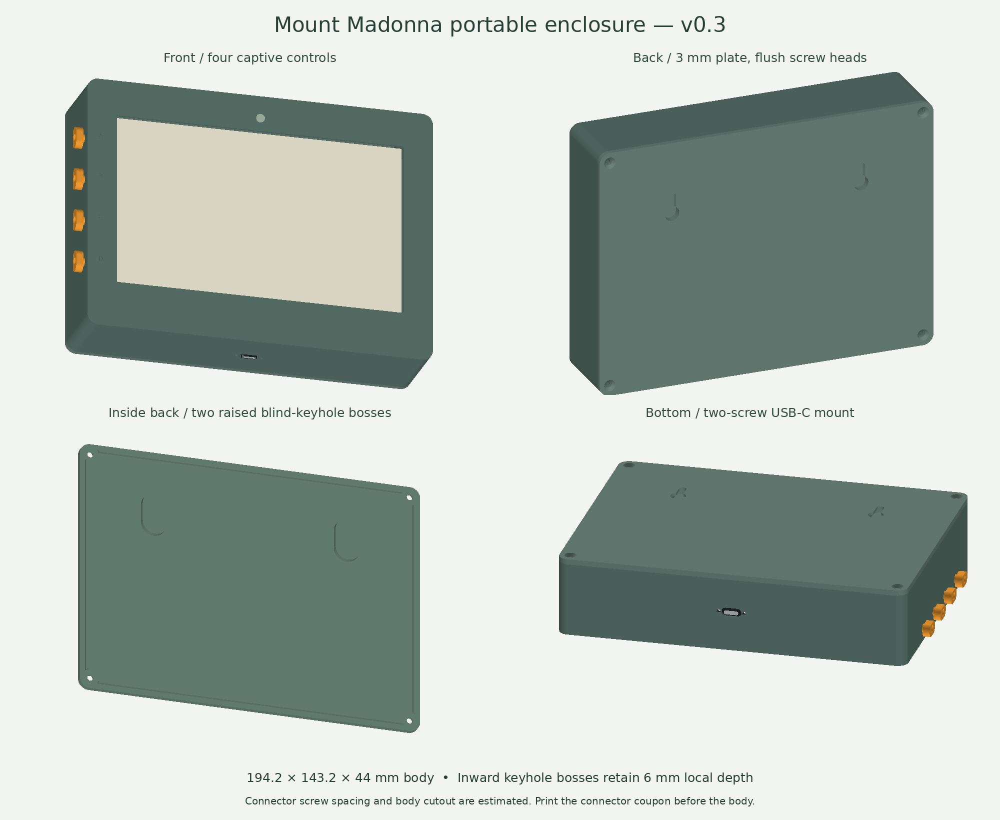

[Download STL, assembly STEP and source package](Mount_Madonna_Case_v0_3.zip) · [Dimension sheet](dimensions.pdf) · [1:1 wall template](wall_template_1to1.pdf)

# Mount Madonna portable Inky case — prototype v0.3

For the **2025 side-button Inky Impression 7.3**, **Pi Zero 2 W**, and
**Waveshare UPS HAT C**. Version 0.3 uses the new **two-screw USB-C connector**
from the user-supplied image. It removes the separate printed connector
retainer from v0.2. The 3 mm back plate, inward blind-keyhole bosses, screw back,
four side controls and corrected **top-centre onboard LED aperture** remain.

**Fit-check prototype.** The user authorized estimation of the connector's
undimensioned mounting features. Print the connector-fit coupon with your actual
part and screws before printing the body. No physical test print has been made.

## Changes and dimensions

- Body remains **194.2 × 143.2 × 44 mm** assembled, excluding projecting controls
  and connector nose. Width with button caps is about 199.4 mm.
- The broad back plate stays **3 mm**; two keyhole bosses project **3 mm inward**
  for **6 mm total local depth**. The blind pockets keep a 1.5 mm inside skin.
- Central spare depth behind the estimated electronics stack is about 8.9 mm;
  nearest keyhole-boss clearance to the stack estimate is about 5.9 mm.
- Keyholes remain 110 mm apart with 10 mm lift-off travel. Rear screws remain
  M3 countersunk/flat-head screws.
- The USB-C connector bolts directly to an integral backing pad at the bottom
  centre. There is **no separate printed connector retainer**.
- The old side cable opening, plug and v0.2 flange-capture recess are absent.
- LED opening: top centre, 3 mm below the top edge of the display PCB.

## New connector: known dimensions versus estimates

[Supplied dimension image](https://m.media-amazon.com/images/I/61LiYKW6amL._SL1500_.jpg)

The image states **19 mm overall flange width**, **5 mm flange height**,
**9 mm nose width**, **11.5 mm overall connector depth**, and about **55.5 mm
pigtail length**. The separate ring/body view is labeled 11 × 5 mm.

The image does **not** dimension screw centres, hole diameter, rear-body
thickness, or flange thickness. The following are estimates, not verified
manufacturer specifications:

| Feature | Model value |
|---|---:|
| Mounting screw centres | **14.2 mm**, estimated from front-view proportions |
| Connector flange holes in reference geometry | 2.0 mm estimated |
| Case screw clearance holes | 2.2 mm for nominal M2 screws |
| Body through-cutout | **11.2 × 5.0 mm** capsule, estimated |
| Reference rear body | 11.0 × 4.8 mm, estimated |
| Reference flange thickness | 1.3 mm, estimated |
| Reference nose extension from flange | 2.0 mm, estimated |
| Integral backing pad depth | 6.5 mm |

The connector is inserted **from inside**. Its flange seats against the interior
of a locally thinned 1.5 mm mounting web; only the USB-C nose passes through the
bottom opening. Two **M2 screws enter from outside**, through 2.2 mm clearance
holes and the connector flange. Use M2 nuts inside unless the actual connector
has suitable threaded holes. Start with M2 × 6 mm pan-head screws and confirm
length and nut clearance on the coupon. The flange recess opens into the case;
there is no separate printed retainer.

Print `connector_fit_coupon.stl` first. Check inside insertion, flange seating,
estimated 14.2 mm screw centres, nut access and full USB plug engagement in both
orientations. Do not force a mismatched connector or screw pattern.

If needed, adjust `connector_screw_spacing`, `connector_cutout_w`, or
`connector_cutout_h` in `parameters.json` and regenerate. A small flat file may
be sufficient for print burrs; do not scale the whole enclosure to change fit.
The image's gasket does not establish that this case will seal against water.

The pigtail is much shorter than the prior connector's and will probably need
an insulated extension or suitable lead to reach the UPS input. Keep relaxed
bends and strain relief. Feed the UPS's **regulated 5 V charging input** through
a suitable lead/verified charging input, preserving the UPS charge circuitry.
Do not connect the USB input to the raw battery. Confirm polarity and the
specific connector's USB-C cable compatibility before connecting electronics.
The pictured two-wire connector should not be assumed to negotiate USB Power
Delivery voltages.

## Print files and hardware

`exports/` contains the printable STLs and `case_assembly.step`. The assembly
includes a bought-connector **reference only**, with estimated details. Do not
print that reference. Its separate STEP is generated by the source script.
The normalized STLs are individually oriented for printing; use the assembly
STEP to inspect assembled coordinates.

| Part | Quantity |
|---|---:|
| body.stl | 1 |
| back_panel.stl | 1 |
| button_plunger.stl | 4 |
| button_cap.stl | 4 |
| led_blank.stl | Optional 1, to cover the onboard light |
| connector_fit_coupon.stl | Print 1 first |
| keyhole_fit_coupon.stl | Print 1 first |
| pcb_fit_gauge.stl | Print 1 first |
| button_fit_coupon.stl | Print 1 first |

There are **nine printable part types**, down from ten in v0.2. The old retainer
and its STL are removed; its two screws are replaced by the connector's direct
mounting screws.

Hardware:

- Four **M3 × 10 mm, 90-degree countersunk/flat-head** rear screws. Countersinks
  are 6.6 mm maximum diameter; pilots are 2.5 mm. Use appropriate plastic
  threading or carefully tap for the chosen screws. No heat-set inserts modeled.
- Four short M2 × 4 mm screws for the display corner mounts.
- Four M2 × 4 mm screws for the button caps.
- Two **M2 × 6 mm** screws and two M2 nuts for the connector; confirm on the coupon and actual
  connector before final assembly.
- Existing Pi/header/UPS spacers and hardware.
- Two wall screws and suitable anchors: shank up to 4 mm, head 7–8 mm diameter,
  thickness up to 2.8 mm. Test with the blind-keyhole coupon.

A 220 × 220 mm build plate is recommended; allow at least 200 × 150 mm usable
area plus skirt/brim. Not split for a 180 mm printer. PETG is a suitable starting
material; ASA is another option if your printer supports it. PLA can soften in
a hot vehicle; keep the battery unit out of heat.

Start at 0.2 mm layers, four perimeters and 20–30% infill. Body front face down;
back exterior/keyhole face down. Back-pocket inside skins bridge about 8.4 mm.
Keep supports out of the sliding pockets and check your printer's bridging.
Caps print outer face down; plungers print screw-pilot end down with a small
brim; their retaining flanges are flared. Connector coupon prints outside face
down; the other coupons/gauge are already oriented. Check guide bores and pilot
holes for burrs before fitting hardware.

## Assembly and checks

Power down and disconnect battery and external supply before handling boards.
Support PCB edges and protect the fragile glass. Use the fit gauges first.

1. Install the display from behind on its four corner pads (168.2 × 117.2 mm
   centres). The glass relief pocket must not clamp the display. Use short M2
   screws gently; verify actual engagement and clearance before tightening.
2. Insert plungers from inside, add outer caps and their M2 × 4 screws. Verify
   every switch is unpressed at rest and returns freely. Check A/B/C/D and the
   ten-second A+D hold. Switch Z and reach remain estimates (`button_z` and
   `button_tip_x`) and may need adjustment.
3. Insert the new connector from inside at the bottom and fasten from outside with the two
   M2 screws. Confirm full USB-plug engagement, adequate threads and strain relief.
   Check its actual internal body does not foul the pad or wiring.
4. Fit Pi and UPS using normal manufacturer hardware. Keep the battery in its
   intended position with expansion space, without compressing the pouch.
   Route insulated wires away from screws, plungers and sharp edges.
5. Check the top-centre aperture aligns with the onboard LED. No added LED or
   wiring is needed. Use the printed blank only if you prefer to hide the light.
6. Dry-fit the back and check both inward bosses clear the actual stack and
   wires. Fit the four countersunk M3 screws without forcing the cover closed.
7. Verify all four views, the update gesture and charging. The UPS power switch
   is accessible after back removal; no external switch lever is modeled.

An optional 0.5 mm clear PET/polycarbonate guard, approximately 169.8 × 110.8 mm,
can sit in the front relief pocket, secured to the plastic rim only. Confirm it
does not contact or press the actual glass, including when flexed.

## Wall and field use

Print `wall_template_1to1.pdf` at Actual Size/100% and check its 100 mm scale
bar. Wall fasteners are 110 mm apart. Adjust head projection for a snug sliding
fit. Place large entries over heads, slide down 10 mm to hang, then lift 10 mm
and pull away to remove. The blind pockets stay closed to the electronics.
Unplug charging power before carrying the unit.

The enclosure is fully backed but has no tested water/dust rating or impact
certification. It is a lift-off wall mount, not a vehicle crash-restraint. Use
sheltered conditions and confirm normal charging temperatures in the assembled
case before extended operation.

## Source and validation

With CadQuery 2.6+ installed: `python build_case.py`, `python check_fit.py`, then
`python validate_stls.py` (NumPy required for mesh checks). Parameters are in
`parameters.json`. Generated reports are under `exports/`.

Checks cover valid single solids, watertight STL edge counts, part collisions,
the estimated connector and electronics envelopes, the top LED opening and the
closed former bottom opening, and closed inside skins on the keyholes. These
checks do not replace physical coupon testing, especially for the estimated
connector dimensions.

Sources:

- [Current user-supplied connector image](https://m.media-amazon.com/images/I/61LiYKW6amL._SL1500_.jpg)
- [Pimoroni Inky specifications](https://shop.pimoroni.com/products/inky-impression)
- [Pimoroni drawing](https://cdn.shopify.com/s/files/1/0174/1800/files/inky-impression-7-drawing.png?v=1781267582)
- [Waveshare UPS HAT C](https://www.waveshare.com/ups-hat-c.htm)
- [Reference frame/button model](https://makerworld.com/en/models/1482862-inky-impression-2025-edition-7-3-frame)
- [Reference enclosure model](https://makerworld.com/en/models/2835228-pimoroni-inky-impression-7-3-v2025-case)

Board 174.2 × 123.2 mm; active area 160 × 96 mm. UPS board 65 × 30 mm;
battery designation 803040. The assembled stack thickness remains an estimate
authorized by the user; central spare space is preserved.
